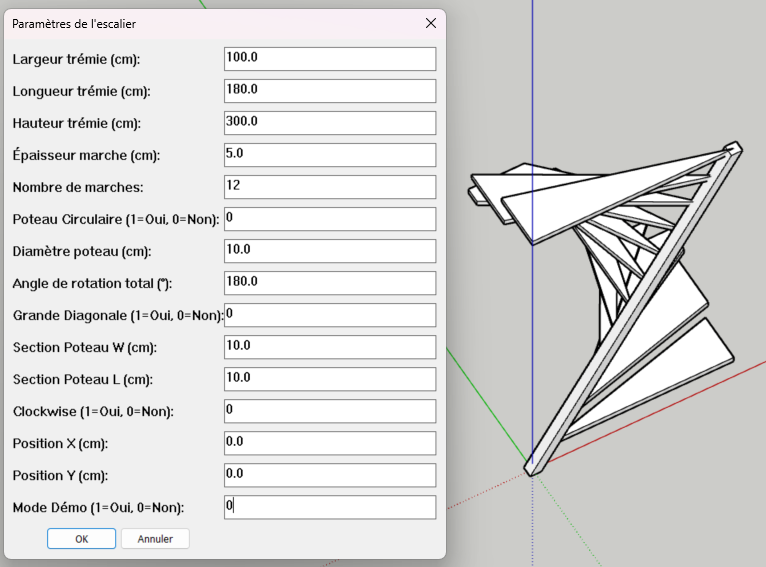

# Générateur d'Escaliers à axe oblique pour SketchUp

Un plugin basé sur Ruby pour SketchUp qui génère automatiquement des escaliers à axes obliques avec une trémie rectangulaire. Cet outil permet un prototypage rapide de designs d'escaliers, gérant aussi bien les configurations à petite qu'à grande diagonale avec précision.

## 🚀 Fonctionnalités

- **Génération Dynamique :** Créez des escaliers instantanément en définissant les dimensions de la trémie.
- **Deux Modes de Diagonale :** 
  - **Petite Diagonale :** l'axe du poteau est parallèle à l'axe des X.
  - **Grande Diagonale :** l'axe du poteau traverse la trémie.
- **Poteau Personnalisable :** Choix entre un poteau cylindrique ou parallélipédique.
- **Contrôle de l'Orientation :** Prise en charge du sens horaire (*clockwise*) et anti-horaire.
- **Positionnement Précis :** Définissez les coordonnées X et Y exactes de l'assemblage dans votre modèle.
- **Mode Démo :** Testez rapidement 4 scénarios prédéfinis pour valider les capacités de l'outil.

## 🧪 Le Mode Démo

Pour faciliter la prise en main et valider le fonctionnement du plugin, un **Mode Démo** est intégré.

Lorsqu'il est activé dans la boîte de dialogue (option "Mode Démo = 1"), le plugin ignore les paramètres manuels pour générer automatiquement quatre scénarios de test distincts. Cela permet de visualiser instantanément :
- La différence entre une petite et une grande diagonale.
- Le rendu des poteaux à sections circulaires versus rectangulaires.
- L'impact du sens de rotation.

| Scénario | Diagonale | Section Poteau | Sens |
| :--- | :--- | :--- | :--- |
| **Cas 1** | Petite | Circulaire | Clockwise |
| **Cas 2** | Petite | Rectangulaire | Anti-Clockwise |
| **Cas 3** | Grande | Circulaire | Clockwise |
| **Cas 4** | Grande | Rectangulaire | Anti-Clockwise |

## 🛠 Installation

Le plugin est fourni au format `.rbz`, le format standard pour les extensions SketchUp.

### Méthode Standard (Recommandée)
1. **Téléchargez** le fichier `.rbz` depuis la section *Releases*.
2. Ouvrez SketchUp.
3. Allez dans le menu **Fenêtre** $\rightarrow$ **Gestionnaire d'extensions** (*Window* $\rightarrow$ *Extension Manager*).
4. Cliquez sur le bouton **Installer l'extension...** en bas à gauche.
5. Sélectionnez le fichier `.rbz` téléchargé et cliquez sur **Ouvrir**.
6. Le plugin est maintenant installé et prêt à l'emploi !

## 📖 Mode d'Emploi

1. Allez dans le menu **Extensions** (ou Plugins).
2. Sélectionnez **"olliwa Escalier Axe Oblique vx.x.x"**.
3. Une boîte de dialogue s'affiche. Remplissez les paramètres requis :
   - **Trémie :** Définissez la largeur, la longueur et la hauteur de l'ouverture.
   - **Marches :** Réglez le nombre de marches et leur épaisseur.
   - **Clockwise :** Détermine la direction dans laquelle l'escalier "monte" et tourne autour du poteau central.
   - **Poteau :** Choisissez la forme (circulaire ou rectangulaire) et les dimensions.
   - **Rotation :** Définissez l'angle de rotation total de l'escalier.
4. Cliquez sur **OK** pour générer. Le plugin créera un groupe comprenant le poteau central et toutes les marches correctement orientées.

### Précisions sur le paramètre Clockwise (Sens Horaire)
Ce paramètre détermine la direction de rotation de l'escalier autour du poteau central :
- **Activé (1) :** L'escalier tourne dans le sens des aiguilles d'une montre.
- **Désactivé (0) :** L'escalier tourne dans le sens inverse des aiguilles d'une montre.

Ce choix influence directement le point de départ et le point d'arrivée des marches par rapport aux dimensions de la trémie.

## ⚙️ Détails Techniques

Le plugin est écrit en Ruby et suit une architecture modulaire :
- `loader.rb` : Gère l'initialisation du plugin et la création du menu.
- `interface.rb` : Gère l'interaction utilisateur et la boîte de dialogue.
- `generator.rb` : L'orchestrateur principal pour la création de la géométrie.
- `logger.rb` : Système de logs centralisé pour le suivi technique.
- `tools.rb` : Utilitaires mathématiques pour les intersections et l'orientation.
- `diaglarge.rb` / `diagsmall.rb` : Logique spécifique selon le type de diagonale.
- `config.rb` : Gestion centralisée des paramètres.

## 🤝 Contribution

Les contributions sont les bienvenues ! Si vous trouvez un bug ou avez une idée de fonctionnalité, n'hésitez pas à ouvrir un *Issue* ou à proposer une *Pull Request*.

## 📄 Licence

Ce projet est sous licence MIT - voir le fichier LICENSE pour plus de détails

