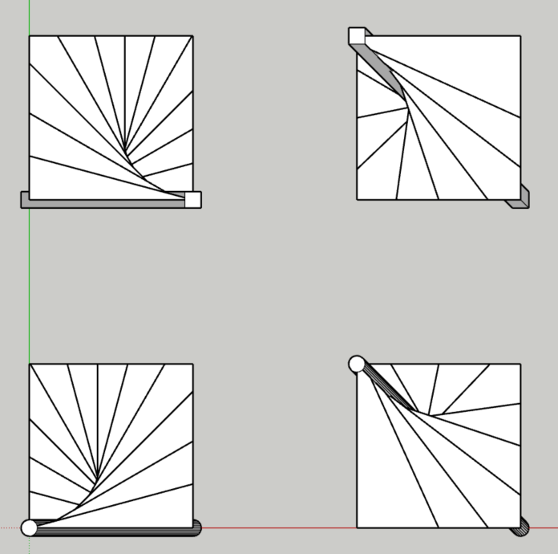
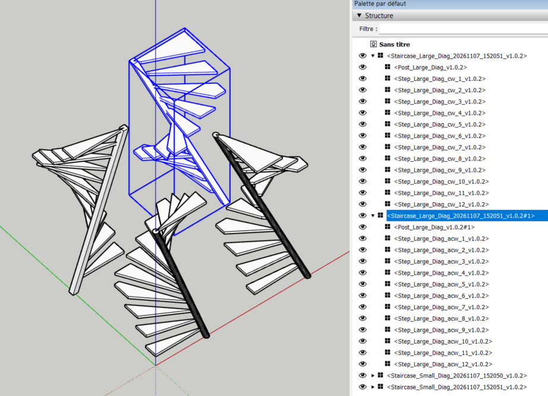
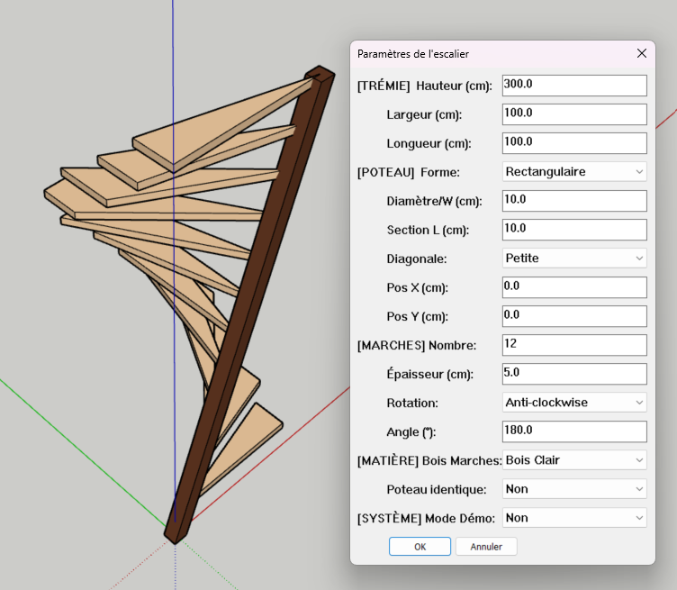
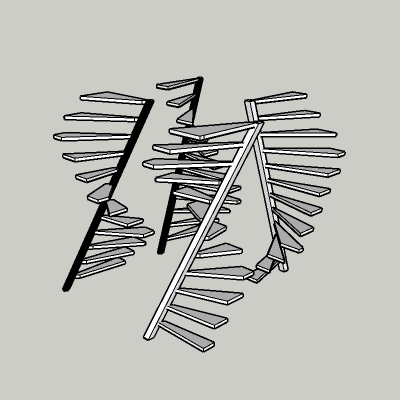
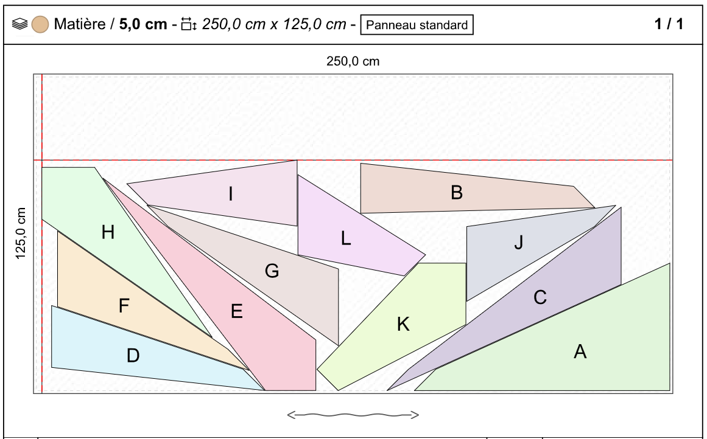

# Générateur d'Escaliers à axe oblique pour SketchUp

Plugin écrit en Ruby pour SketchUp qui génère automatiquement des escaliers à axes obliques avec une trémie rectangulaire. Cet outil permet un prototypage rapide de designs d'escaliers, gérant aussi bien les configurations à petite qu'à grande diagonale.

## 🚀 Fonctionnalités

- **Génération Dynamique :** Création des escaliers en définissant les dimensions de la trémie.
- **Deux Modes de Diagonale :** 
  - **Petite Diagonale :** L'axe du poteau est parallèle à l'axe des X.
  - **Grande Diagonale :** L'axe du poteau traverse la trémie.
- **Poteau Personnalisable :** Choix entre un poteau cylindrique ou parallélipédique.
- **Contrôle du sens de rotation :** Prise en charge du sens horaire (*clockwise*) et anti-horaire.
- **Positionnement de l'escalier :** vecteur de translation de l'escalier par rapport aux axes du modèle.
- **Gestion des Matières :** Personnalisation des finitions avec un choix de essences de bois (Clair ou Foncé) pour les marches et le poteau, avec une option de synchronisation automatique entre poteau et marches.
- **Mode Démo :** Tester rapidement 4 scénarios prédéfinis pour valider les capacités de l'outil.

## 🧪 Le Mode Démo

Pour faciliter la prise en main et valider le fonctionnement du plugin, un **Mode Démo** est intégré.

Lorsqu'il est activé dans la boîte de dialogue (option "Mode Démo = 1"), le plugin ignore les paramètres manuels pour générer automatiquement quatre scénarios de test distincts. Cela permet de visualiser instantanément :
- La différence entre une petite et une grande diagonale.
- Le rendu des poteaux à sections circulaires versus rectangulaires.
- L'impact du sens de rotation.

| Scénario | Diagonale | Section Poteau | Sens |
| :--- | :--- | :--- | :--- |
| **Cas 1** | Petite | Circulaire | Clockwise |
| **Cas 2** | Petite | Rectangulaire | Anti-Clockwise |
| **Cas 3** | Grande | Circulaire | Clockwise |
| **Cas 4** | Grande | Rectangulaire | Anti-Clockwise |

## 🛠 Installation

Le plugin est fourni au format `.rbz`, le format standard pour les extensions SketchUp.

### Méthode Standard (Recommandée)
1. **Télécharger** le fichier `.rbz` depuis la section *Releases*.
2. Ouvrir SketchUp.
3. Aller dans le menu **Fenêtre** $\rightarrow$ **Gestionnaire d'extensions** (*Window* $\rightarrow$ *Extension Manager*).
4. Cliquer sur le bouton **Installer l'extension...** en bas à gauche.
5. Sélectionner le fichier `.rbz` téléchargé et cliquez sur **Ouvrir**.
6. Le plugin est maintenant installé et prêt à l'emploi !

## 📖 Mode d'Emploi

1. Aller dans le menu **Extensions** (ou Plugins).
2. Sélectionner **"olliwa Escalier Axe Oblique vx.x.x"**. Deux sous-menus sont proposés
   - **Lancer l'outil vx.x.x**
   - **Aide/Documentation**
3. Une boîte de dialogue s'affiche. Remplir les paramètres requis :
   - **Trémie :** la largeur, la longueur et la hauteur de l'ouverture.
   - **Poteau :** 
      - la forme (circulaire ou rectangulaire)
      - les dimensions, 
      - le type de diagonale
      - la position du composant de l'escalier  
   - **Marches :** 
      - le nombre de marches,
      - leur épaisseur,
      - le sens de rotation de l'escalier clockwise ou anti-clockwise
      - l'angle de rotation total de l'escalier.
   - **Matieres :** 
      - le type de bois entre "Bois Clair" et "Bois Foncé" pour l'ensemble de l'escalier.
      - la même finition pour le poteau et les marches ou rester dans une finition distincte.
4. Cliquer sur **OK** pour créer l'escalier. Le plugin créera un composant comprenant le composant du poteau central et les composants de toutes les marches.

### Précisions sur le paramètre Clockwise (Sens Horaire)
Ce paramètre détermine la direction de rotation de l'escalier autour du poteau central :
- **Clockwise  :** L'escalier tourne dans le sens des aiguilles d'une montre.
- **Anti-Clockwise :** L'escalier tourne dans le sens inverse des aiguilles d'une montre.

Ce choix influence directement le point de départ et le point d'arrivée des marches par rapport aux dimensions de la trémie.

## ⚙️ Détails Techniques

Le plugin est écrit en Ruby et suit une architecture modulaire :
- `loader.rb` : Gère l'initialisation du plugin et la création du menu.
- `interface.rb` : Gère l'interaction utilisateur et la boîte de dialogue.
- `generator.rb` : L'orchestrateur principal pour la création de la géométrie.
- `logger.rb` : Système de logs centralisé pour le suivi technique.
- `tools.rb` : Utilitaires mathématiques pour les intersections et l'orientation.
- `diaglarge.rb` / `diagsmall.rb` : Logique spécifique selon le type de diagonale.
- `config.rb` : Gestion centralisée des paramètres.

## 🤝 Contribution

Les contributions sont les bienvenues ! Si vous trouvez un bug ou avez une idée de fonctionnalité, n'hésitez pas à ouvrir un *Issue* ou à proposer une *Pull Request*.

## 📄 Licence

Ce projet est sous licence MIT - voir le fichier LICENSE pour plus de détails

Calepinage avec OpenCutList [OCL](https://docs.opencutlist.org/)
