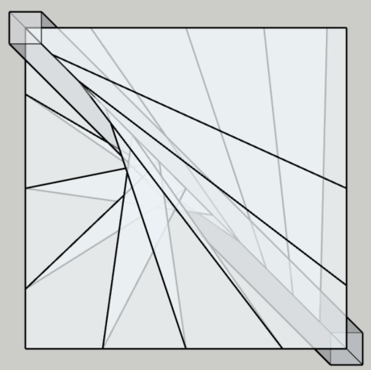

# Analyse Technique : Module `DiagLarge` 

Ce document présente l'analyse logicielle du module `DiagLarge`, responsable de la génération géométrique des marches suivant l'algorithme pour les "Grandes Diagonales".

## 1. Architecture du Flux de Données

L'implémentation est divisée en deux phases distinctes pour séparer le calcul mathématique de la manipulation d'objets SketchUp.

### Phase A : Pré-calcul (Calculs Vectoriels)
L'algorithme itère sur le nombre de marches pour déterminer les points de contrôle dans l'espace 3D avant toute création d'entité :
- **Trigonométrie circulaire** : Utilisation d'un cercle guide (rayon $R = \text{largeur}/2$) pour définir le point cible $C2$ de chaque marche.
- **Interpolation linéaire** : Le point d'ancrage $C1$ est calculé par un décalage (`offset`) proportionnel sur le vecteur du poteau.
- **Intersection géométrique** : Le module délègue à `StairPluginSquare::Tools.intersect_with_box_large` la détermination du point $C3$, assurant que la marche s'arrête précisément aux limites de l'ouverture.

### Phase B : Construction Géométrique (Dessin)
Une fois les données stabilisées dans le tableau `stair_data`, le moteur procède à la création physique :
- **Topologie planaire** : Les points sont projetés sur le plan $Z$ de la marche actuelle pour garantir une surface parfaitement horizontale.
- **Gestion des contours** : L'algorithme vérifie si les points $C3$ et $C4$ appartiennent au même mur. Si ce n'est pas le cas, un point de coin est injecté pour éviter les vides structurels.
- **Optimisation de la face** : L'utilisation d'un `convex_hull` (enveloppe convexe) sécurise la création de la face supérieure en éliminant ainsi la création d'un polygone croisé.

## 2. Analyse de l'Implémentation Volumétrique

Le code évite l'outil `pushpull` natif de SketchUp, souvent source d'erreurs de topologie sur des géométries complexes, au profit d'une **construction manuelle de volume** :
1. Génération de la face supérieure (Top).
2. Génération de la face inférieure (Bottom) via un vecteur de translation $-\text{thickness}$.
3. Fermeture du volume par la création systématique de faces latérales reliant chaque segment supérieur à son homologue inférieur.
4. Normalisation des normales via `orient_faces_outward` pour garantir un rendu visuel correct.

## 3. Points Critiques et Robustesse

### Gestion des erreurs et Stabilité
- **Encapsulation `begin...rescue`** : Chaque marche est traitée dans un bloc de capture d'erreur indépendant. Un échec sur une marche spécifique ne bloque pas la génération de l'ensemble de l'escalier.
- **Logging** : L'implémentation utilise `StairObliqueLogger` plutôt que des `puts`, permettant un diagnostic précis en production sans polluer la console utilisateur.
- **Sécurité géométrique** : L'usage de `rescue nil` sur `add_face` prévient les plantages lors de la tentative de création de faces dégénérées (points superposés).

### Complexité et Performance
- **Complexité Temporelle** : $O(N)$ où $N$ est le nombre de marches. Le coût computationnel est linéaire et négligeable pour des structures architecturales standards.
- **Complexité Spatiale** : Faible, avec un stockage temporaire des points de contrôle avant l'instanciation des composants.

## 4. Observations pour Évolutions Futures

- **Dépendances** : Le module est fortement couplé au module `Tools`. Toute modification de la logique d'intersection ou de calcul de coin impactera directement `DiagLarge`.
- **Optimisation** : L'utilisation de `model.definitions.add` pour chaque marche permet une gestion efficace de la mémoire via les instances, facilitant les modifications globales de thickness ou de matériaux.