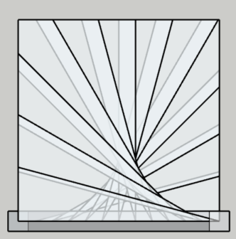

# Analyse Technique : Module `DiagSmall` 

Ce document présente l'analyse logicielle du module `DiagSmall`, responsable de la génération des marches selon l'algorithme pour les "Petites Diagonales".

## 1. Logique Algorithmique

Contrairement à l'approche par cercle imaginaire du module `DiagLarge`, le module `DiagSmall` repose sur une **projection vectorielle directe** depuis le poteau.

### Mécanisme de Calcul
Pour chaque marche, le système définit un secteur angulaire :
- **Vecteurs Directeurs** : Deux vecteurs unitaires ($\vec{v1}$ et $\vec{v2}$) sont calculés à partir de l'angle actuel et de l'angle de la marche suivante.
- **Projection et Intersection** : Le module projette ces vecteurs depuis le point d'ancrage $A$ (sur le poteau) vers les limites de l'ouverture. Les points d'impact $B$ (début de marche) et $C$ (fin de marche) sont déterminés par l'appel à `StairPluginSquare::Tools.intersect_with_box_small`.
- **Positionnement Vertical** : L'altitude $Z$ est calculée linéairement, avec une légère correction négative (`- 1.mm`) pour éviter les problèmes de coïncidence de faces (z-fighting) lors du rendu.

## 2. Construction Géométrique et Topologique

Le module transforme les points de calcul en composants 3D via un processus de maillage manuel.

### Définition du Polygone
La face supérieure de la marche est construite selon la séquence suivante :
1. **Points de Base** : Le segment $[A, B]$ définit le départ de la marche.
2. **Analyse de Continuité** : Le système vérifie si les points $B$ et $C$ se situent sur le même plan mural via `on_same_wall?`.
3. **Injection de Sommet** : Si la marche change de mur, un point de coin $M$ est inséré pour épouser parfaitement l'angle droit de l'ouverture.
4. **Fermeture** : Le point $C$ ferme le polygone.

### Génération du Volume
Le volume est créé par extrusion manuelle :
- **Faces Parallèles** : Création d'une face supérieure (`pts_top`) et d'une face inférieure (`pts_bottom`) décalée selon la valeur de `thickness`.
- **Sutures Latérales** : Un cycle itératif relie chaque arête supérieure à l'arête inférieure correspondante, fermant ainsi hermétiquement le volume.
- **Normalisation** : Application de `orient_faces_outward` pour garantir la cohérence des normales des faces.

## 3. Analyse de l'Implémentation Logicielle

### Points Forts
- **Précision Angulaire** : L'approche vectorielle garantit que l'ouverture angulaire entre chaque marche est strictement identique.
- **Modularité** : Le recours systématique au module `Tools` pour les intersections et la gestion des coins permet de centraliser la logique géométrique complexe.
- **Gestion des Instances** : L'utilisation de `model.definitions` assure que chaque marche est un composant unique, optimisant les performances de SketchUp.

### Gestion des Erreurs
- **Validation d'Intersection** : Le bloc `if pointB && pointC` agit comme un garde-fou, empêchant la tentative de création de géométries impossibles si les vecteurs ne rencontrent pas les parois.
- **Résilience** : L'utilisation de `rescue nil` lors de l'ajout de faces protège le plugin contre les erreurs de topologie (faces colinéaires ou points superposés).

## 4. Comparaison Synthétique (Small vs Large Diagonal)

| Caractéristique | DiagSmall | DiagLarge |
| :--- | :--- | :--- |
| **Origine du calcul** | Vectorielle (depuis le poteau) | Trigonométrique (depuis un centre) |
| **Définition des bords** | Deux vecteurs ($\vec{v1}, \vec{v2}$) | Un point cible $C2$ sur cercle |
| **Construction** | Directe dans la boucle | Phase de pré-calcul $\rightarrow$ Dessin |
| **Topologie** | Polygone $A \rightarrow B \rightarrow (M) \rightarrow C$ | Polygone $C1 \rightarrow C3 \rightarrow (M) \rightarrow C4 \rightarrow C5$ |