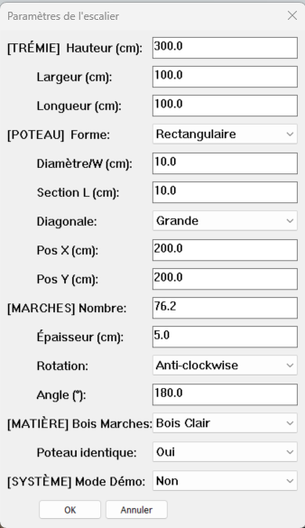

# 🛠 Documentation Technique : Module Interface

## Présentation
Le module `Interface` sert de pont entre les paramètres de configuration (`Config`) et l'utilisateur final via l'API `UI.inputbox` de SketchUp. Son rôle est de transformer des données techniques (unités internes SketchUp) en valeurs lisibles (centimètres, labels) et de valider les saisies avant leur application.

## 🏗 Architecture du Flux de Données
Le module suit un cycle de transformation strict pour garantir la stabilité du plugin :

**`Config (Unités Internes)`** $\rightarrow$ **`Interface (Strings/cm)`** $\rightarrow$ **`Validation (Casting/Check)`** $\rightarrow$ **`Config (Unités Internes)`**

### 1. Le Schéma de Mapping (`SCHEMA`)
Plutôt que d'utiliser des index numériques (`input[0]`, `input[1]`), l'interface repose sur un **Hash de Mapping**. 
*   **L'objectif :** Rendre l'interface extensible. 
*   **Maintenance :** Pour ajouter un nouveau paramètre, il suffit d'ajouter une entrée dans `SCHEMA`. Le reste du code (prompts, défauts, listes et validation) s'adapte automatiquement via des itérations `.map` et `.each`.

### 2. Gestion des Unités et Defaults
L'interface doit convertir les valeurs de `Config` pour l'affichage :
*   **Dimensions :** Conversion via `.to_cm` pour l'affichage utilisateur.
*   **Valeurs Pures :** Le nombre de marches (`num_steps`) et l'angle (`total_rotation_angle`) sont traités comme des nombres bruts et **ne doivent jamais** subir de conversion de distance.
*   **Énumérations :** Conversion des booléens en labels explicites (ex: `true` $\rightarrow$ `"Circulaire"`).

### 3. Pipeline de Validation (`validate_and_sanitize`)
C'est la barrière de sécurité du plugin. Aucune valeur saisie par l'utilisateur n'est envoyée directement au `Generator`.
*   **Casting Strict :** Conversion forcée via `.to_f` ou `.to_i`.
*   **Vérification de Plage :** Comparaison avec `VALIDATION_RULES` (min/max) pour éviter des géométries impossibles (ex: marches négatives ou trémies de 100 mètres).
*   **Validation d'Enum :** Vérification que la valeur choisie appartient bien aux listes autorisées (`ALLOWED_MATERIALS`, etc.).

## ⚙️ Guide de Maintenance

### Ajouter un nouveau paramètre
Pour ajouter une option à l'interface, suivez ces 3 étapes :

1.  **`SCHEMA`** : Ajouter la clé, le libellé du prompt, la clé de config correspondante, la liste déroulante (si applicable) et le type (`:float`, `:integer`, `:bool`, `:string`).
2.  **`VALIDATION_RULES`** : Définir les limites `min` et `max` pour ce paramètre.
3.  **`apply_configuration`** : Ajouter la ligne `Config.set(:ma_cle, params[:ma_cle])` pour enregistrer la valeur validée.

### Debugging courant
*   **Valeurs aberrantes à l'affichage :** Vérifier si le paramètre est correctement classé dans `build_default_for` (distinguer les dimensions physiques des valeurs numériques pures).
*   **Crash à la validation :** Vérifier que la clé utilisée dans `VALIDATION_RULES` correspond exactement à la clé définie dans le `SCHEMA`.

## ⚠️ Points de Vigilance
*   **L'ordre des éléments :** L'ordre dans le `SCHEMA` détermine l'ordre d'apparition dans la boîte de dialogue.
*   **Tolérance SketchUp :** Les valeurs validées sont envoyées au `Generator`. Attention à ne pas autoriser des valeurs trop petites (ex: `< 0.1.mm`) qui provoqueraient des erreurs de création de faces dans le moteur de SketchUp.