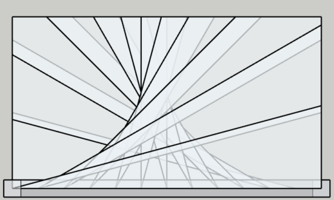

# Analyse Technique : Module `Tools` (Utilitaires Géométriques)

Ce document analyse le module `Tools`, qui sert de moteur de calcul géométrique pour le plugin d'escaliers. Ce module centralise les opérations mathématiques complexes, isolant la logique de calcul pur de la logique de construction d'objets SketchUp.

## 1. Analyse des Algorithmes d'Intersection

Le module propose deux méthodes d'intersection avec le rectangle de l'ouverture, adaptées aux deux stratégies de génération (Small et Large Diagonals).

### `intersect_with_box_small`
Cette méthode recherche le **premier point de contact** (le plus proche de l'origine) entre un rayon et le rectangle.
- **Logique** : Elle calcule les intersections potentielles sur les quatre cotés du rectangle.
- **Filtrage** : Elle ne conserve que les valeurs de $t > 0.01$ et vérifie que le point d'impact se situe effectivement dans les limites du segment opposé.
- **Cas Particulier** : Si l'origine est déjà à l'intérieur de la boîte, elle retourne l'origine, évitant ainsi des erreurs de calcul pour des points d'ancrage internes.

### `intersect_with_box_large`
Contrairement à la version "small", cette méthode recherche le **point d'intersection le plus éloigné** (`t_vals.max`).
- **Objectif** : Cette approche est cruciale pour l'algorithme des "Large Diagonals" où la marche doit s'étendre jusqu'au bord extérieur de l'ouverture, même si elle traverse une zone interne.
- **Rigueur** : Utilise un vecteur normalisé pour garantir que la distance $t$ est exprimée en unités réelles.

## 2. Topologie et Cohérence Spatiale

Le module contient des outils critiques pour garantir que les volumes générés sont "propres" et physiquement cohérents.

### Gestion des Normales (`orient_faces_outward`)
Pour éviter les faces inversées (faces "blanches" vs "bleues" dans SketchUp), le module implémente un système de normalisation basé sur le centroïde :
1. Calcul du **centroïde global** du volume (moyenne pondérée des centres de faces par leur aire).
2. Pour chaque face, calcul d'un vecteur allant du centroïde vers le centre de la face.
3. Si le produit scalaire entre ce vecteur et la normale de la face est négatif, la face est inversée.

### Résolution des Coins (`find_correct_corner`)
Cette méthode résout le problème des marches qui changent de mur. Elle identifie sur quel axe (X ou Y) et quelle limite (Min ou Max) se situent les points de départ et d'arrivée, puis déduit mathématiquement les coordonnées du sommet du rectangle pour créer un point de passage obligatoire.

## 3. Optimisation Géométrique : L'Enveloppe Convexe

L'implémentation de `convex_hull` via l'algorithme **Monotone Chain**. 

- **Problème résolu** : Lors de la génération de marches, plusieurs points peuvent être collectés (ancrages, intersections, coins). Si ces points sont ajoutés dans un ordre incorrect ou s'ils sont colinéaires, SketchUp peut échouer à créer la face.
- **Solution** : L'algorithme trie les points et construit deux "coques" (supérieure et inférieure) en utilisant le produit vectoriel pour éliminer les points concaves.
- **Résultat** : On obtient un polygone minimal et convexe, garantissant la création systématique et stable de la face supérieure de la marche.

## 4. Synthèse 

- **Découplage** : La séparation nette entre les calculs de $t$ (paramétrique) et la création d'entités rend le code testable et maintenable.
- **Robustesse numérique** : L'usage systématique d'une valeur `eps` (epsilon) pour les comparaisons de flottants évite les erreurs de précision inhérentes à la géométrie 3D.
- **Intelligence Topologique** : L'enveloppe convexe et l'orientation des faces montrent une compréhension profonde des limitations du moteur de rendu de SketchUp.

- **Optimisation** : La méthode `calculate_global_centroid` pourrait être optimisée en utilisant les `bounds` du composant plutôt qu'une itération sur toutes les faces pour les volumes simples.
- **Généricité** : Le module pourrait être étendu pour supporter des ouvertures non rectangulaires en remplaçant les tests `x_min/x_max` par des tests d'intersection avec des segments de droite génériques.